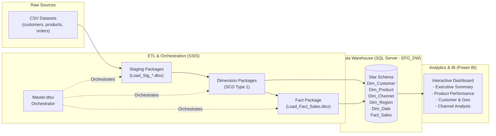

# EFG Holding — Performance Dashboard & End-to-End BI Pipeline

An enterprise-grade, end-to-end Business Intelligence solution built for **EFG Holding**. This project transforms raw transactional data into actionable executive insights through a multi-tier pipeline: Staging $\rightarrow$ Dimensional Data Warehouse (Star Schema) $\rightarrow$ SSIS Orchestration $\rightarrow$ Interactive Power BI Dashboard.

---

## 🏗️ Architecture Overview



---

## 📁 Repository Structure

```text
├── Dashboard/
│   ├── EFG.pbix                   # Power BI Report file
│   └── EFG_Theme.json             # Custom Power BI Theme definition
├── Data/
│   ├── customers.csv              # Customer demographics & signups
│   ├── products.csv               # Product catalog, unit price & cost
│   ├── orders.csv                 # Raw transactional orders
│   └── FactSales_Unmatched.csv     # Error handling & audit redirect
├── SQL/
│   └── 01_create_dw_schema.sql    # DDL for database, schemas, tables & Dim_Date
├── SSIS/
│   └── Integration Services Project1/
│       ├── load_stg_cutomers.dtsx # Ingest raw customer CSV into stg.Customers
│       ├── load_stg_products.dtsx # Ingest raw product CSV into stg.Products
│       ├── load_stg_orders.dtsx   # Ingest raw orders CSV into stg.Orders
│       ├── load_dim_customer.dtsx # Dimension load with region lookup
│       ├── load_dim_products.dtsx # Product dimension with margins calculation
│       ├── load_fact_sales.dtsx   # Fact load with multi-lookups & metric derivations
│       └── master.dtsx            # Master orchestrator with precedence constraints
├── STAR_SCHEMA_DESIGN.md          # Architectural ERD & grain documentation
└── README.md                      # Project documentation
```

---

## 🛠️ Tech Stack & Tools

* **Database Engine:** Microsoft SQL Server (2022 Developer Edition)
* **ETL Platform:** SQL Server Integration Services (SSIS) via Visual Studio 2022
* **Data Modeling:** Dimensional Star Schema (Kimball Methodology)
* **Visualization & Analytics:** Microsoft Power BI Desktop & DAX
* **Version Control:** Git & GitHub

---

## 🗄️ Data Warehouse & Star Schema Design

The `EFG_DW` data warehouse is structured around a central **Fact_Sales** table at the grain of **one row per order line item**, linked to 5 conforming dimensions via integer surrogate keys (`IDENTITY(1,1)`):

* **`dbo.Dim_Customer`**: Tracks customer demographics (`AgeGroup`, `City`, `Region`, `SignupDate`).
* **`dbo.Dim_Product`**: Contains catalog pricing, unit cost, and profit margins (`Margin`, `MarginPct`).
* **`dbo.Dim_Region`**: Standardized geographic groupings for Egyptian cities (Cairo, Giza, Alexandria, Tanta).
* **`dbo.Dim_Channel`**: Sales avenues (`Subscription` vs. `One-time`).
* **`dbo.Dim_Date`**: Full calendar dimension (2024–2026) with `YYYYMMDD` integer surrogate key (`DateSK`).
* **`dbo.Fact_Sales`**: Captures sales volume and computed financials:
  $$\text{TotalSales} = \text{Quantity} \times \text{ListPrice}$$
  $$\text{TotalCost} = \text{Quantity} \times \text{Cost}$$
  $$\text{GrossProfit} = \text{TotalSales} - \text{TotalCost}$$

---

## ⚡ ETL Pipeline (SSIS)

The automated ETL workflow guarantees idempotency (safe to re-run without duplicate records):

1. **Staging Layer (`stg.*`)**: Truncates staging tables before reading CSVs; handles data type conversions and whitespace cleaning.
2. **Dimension Layer (`dbo.Dim_*`)**: Implements **SCD Type 1** via SSIS Lookup transformations, separating new inserts from existing records.
3. **Fact Layer (`dbo.Fact_Sales`)**:
   * Multi-stage lookups against `Dim_Date`, `Dim_Customer`, `Dim_Product`, and `Dim_Channel`.
   * Calculates financial metrics on the fly via Derived Column transformations.
   * Redirects unmatched or erroneous foreign keys to `FactSales_Unmatched.csv` for data governance.
4. **Master Orchestration (`master.dtsx`)**: Executes Staging $\rightarrow$ Dimensions $\rightarrow$ Fact sequentially using Precedence Constraints.

---

## 📊 Power BI Analytics & DAX

The Power BI model features custom business metrics and interactive cross-filtering:

### Key DAX Measures
* **Total Revenue:** `SUM(Fact_Sales[TotalSales])`
* **Total Cost:** `SUM(Fact_Sales[TotalCost])`
* **Gross Profit:** `[Total Revenue] - [Total Cost]`
* **Gross Margin %:** `DIVIDE([Gross Profit], [Total Revenue], 0)`
* **Total Orders:** `DISTINCTCOUNT(Fact_Sales[OrderID])`
* **Average Order Value (AOV):** `DIVIDE([Total Revenue], [Total Orders], 0)`
* **Prior Month Revenue:** `CALCULATE([Total Revenue], DATEADD('Dim_Date'[FullDate], -1, MONTH))`
* **MoM Revenue Growth %:** `DIVIDE([Total Revenue] - [Prior Month Revenue], [Prior Month Revenue], 0)`

### Dashboard Views
1. **Executive Summary:** High-level KPI cards, sparklines, and monthly revenue trends.
2. **Product & Category Performance:** Category revenue breakdown, margin percentages, and product ranking.
3. **Customer & Geographic Analysis:** Revenue by region/city, age distribution, and customer acquisition timeline.
4. **Channel Analysis:** Subscription vs. one-time volume, revenue share, and channel-level AOV comparison.

---

## 👤 Author
* **Ahmed Hassan**
* GitHub: [@sorLegacy](https://github.com/sorLegacy)
