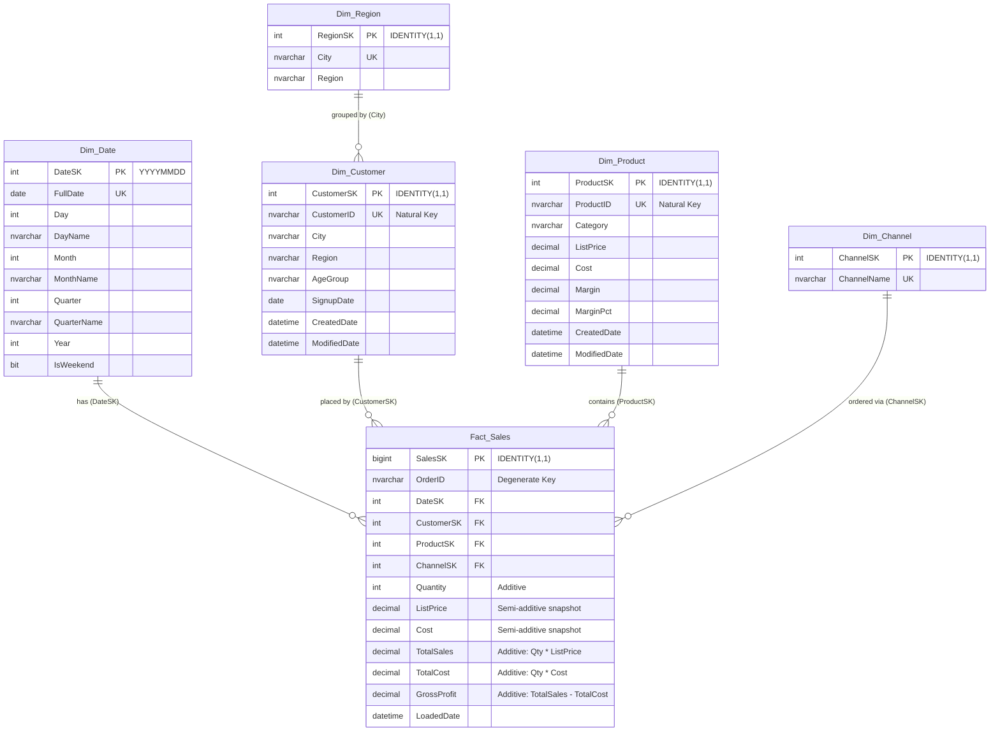

# Star Schema Architecture: EFG_DW

## 1. Schema Overview

The Data Warehouse implements a **Star Schema** centered around the transactional sales grain (1 row per order line), supported by 5 dimensions.

---

## 2. Table Specifications

### A. Fact Table: `dbo.Fact_Sales`
* **Grain:** 1 record per order line item.
* **Foreign Keys:**
  * `DateSK` $\rightarrow$ `dbo.Dim_Date(DateSK)`
  * `CustomerSK` $\rightarrow$ `dbo.Dim_Customer(CustomerSK)`
  * `ProductSK` $\rightarrow$ `dbo.Dim_Product(ProductSK)`
  * `ChannelSK` $\rightarrow$ `dbo.Dim_Channel(ChannelSK)`
* **Measures:**
  * `Quantity`: Units sold.
  * `ListPrice`: Unit selling price at time of sale.
  * `Cost`: Unit cost at time of sale.
  * `TotalSales`: `Quantity * ListPrice`.
  * `TotalCost`: `Quantity * Cost`.
  * `GrossProfit`: `TotalSales - TotalCost`.

### B. Staging Layer: `stg.*`
* `stg.Customers`: Raw landing for `customers.csv`.
* `stg.Products`: Raw landing for `products.csv`.
* `stg.Orders`: Raw landing for `orders.csv`.
